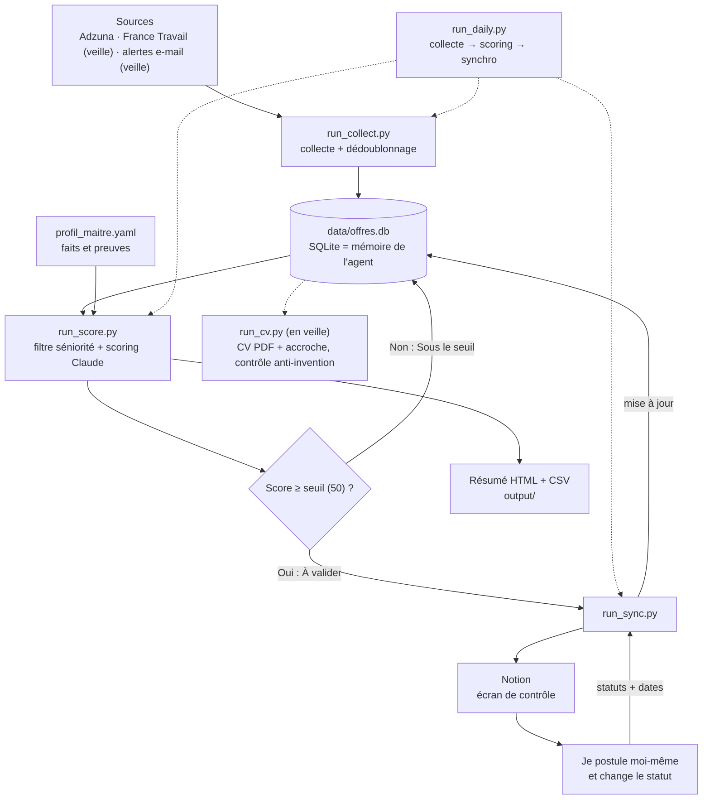

# Agent emploi

Agent local qui collecte des offres, les note de 0 à 100 d’après mon profil, les envoie dans Notion et suit mes candidatures.
**L’agent prépare, je décide** : il n’envoie jamais de candidature et ne supprime rien.

## En clair

- **Le problème** : repérer chaque jour les offres pertinentes parmi des centaines, sans y passer des heures.
- **Ce que fait l’agent** : il collecte les offres, écarte les doublons et les postes hors de mon niveau, puis note chaque offre d’après des faits vérifiés sur mon parcours.
- **Ce que je garde** : la décision. Je valide dans Notion et je postule moi-même.
- **Garde-fou** : rien n’est écrit ni noté en dehors d’un profil de faits vérifiés, donc l’agent n’invente aucune compétence.
- **Transposable à une PME** : le même principe (collecter, noter selon vos critères, soumettre à validation, suivre les statuts) s’applique à la veille concurrentielle, à la prospection ou au tri de demandes entrantes.

*Projet développé par Aurélien Prat, APBI : Data, Automatisation & IA pour PME.*

## Workflow



Notion et SQLite sont reliés par la clé `dedupe_key` (colonne « Clé SQLite »). Notion fait foi pour mes statuts, SQLite pour le score.

## Fichiers du workflow

| Fichier | Rôle | Objectif |
| --- | --- | --- |
| `config.yaml` | Pistes (S1 Data/BI, S2 Commercial, S3 Reporting), zones, seuil, modèles, bloc `notion` | Régler l’agent sans toucher au code |
| `data/profil_maitre.yaml` | Faits vérifiés sur mon parcours, avec identifiants | Source unique de vérité : rien n’est écrit ni noté hors de ce profil |
| `.env` | Clés API (Adzuna, Anthropic, Notion, Gmail) | Garder les secrets hors du code et de git |
| **Collecte** |  |  |
| `run_collect.py` | Lance les requêtes (piste × zone × mot-clé) | Alimenter la base chaque jour |
| `connectors/adzuna.py` | Interroge l’API Adzuna | Source principale d’offres |
| `connectors/france_travail.py` | Interroge l’API France Travail | Source d’offres (désactivée en attendant l’accès API) |
| `connectors/email_alerts.py` | Lit les alertes LinkedIn, Indeed, HelloWork… (IMAP, lecture seule) | Source d’offres sans scraping (en veille) |
| `run_add.py` | Ajout manuel d’une offre | Saisir une offre repérée ailleurs |
| **Mémoire et filtres** |  |  |
| `core/models.py` | Format commun d’une offre, détection du contrat et du mode | Uniformiser les offres de toutes les sources |
| `core/db.py` | Base SQLite : dédoublonnage, scores, statuts, date de candidature | Ne jamais re-scorer (ni payer) deux fois la même offre |
| `core/filters.py` | Écarte les titres senior / lead / manager | Ne pas dépenser de score sur des postes hors de mon niveau |
| **Scoring** |  |  |
| `run_score.py` | Un passage de 300 offres max, répartis par piste ; génère le résumé | Noter les offres et produire la liste du jour |
| `core/scoring.py` | Prompt, grilles par piste, pénalités, plafonds, garde-fous | Note fiable, avec preuves citées, sans invention |
| `core/profile.py` | Charge le profil et expose les faits utilisables | Donner à Claude uniquement des faits vérifiés |
| `core/digest.py` | Génère `output/offres_AAAA-MM-JJ.html` et `.csv`, masque les offres traitées | Lire et trier les offres dans le navigateur ou Excel |
| **Notion** |  |  |
| `run_sync.py` | Importe mes statuts depuis Notion, remplit les dates de candidature, envoie les nouvelles offres | Relier Notion et SQLite dans les deux sens |
| `core/notion_sync.py` | Client API Notion, correspondance des statuts, règles de synchro | Cœur de la synchro, idempotent, sans suppression |
| `check_notion.py` | Vérifie le jeton, le partage de la base, les colonnes et les statuts | Diagnostiquer un souci de connexion |
| **Orchestration** |  |  |
| `run_daily.py` | Enchaîne collecte, scoring et synchro (`--skip-collect/-score/-sync`) | Une seule commande par jour, planifiable (`schtasks`) |
| `check_setup.py` | Teste les clés et les connexions (Adzuna, Anthropic, Gmail…) | Vérifier l’installation |
| **En veille** |  |  |
| `run_cv.py` | Génère CV + accroche d’une offre | Préparer une candidature |
| `core/cv_plan.py` | Plan de CV par le LLM, contrôle déterministe (ids, chiffres, termes interdits, Fabric « en formation ») | Aucune invention possible dans le CV |
| `core/cv_render.py` | Rendu PDF du CV (T1 1 page, T2 2 pages) | Produire le CV final |
| `run_emails.py` | Lit les alertes e-mail et les ajoute à la base | Brancher la source e-mail |

`tests/` : tests automatiques (`python -m pytest -q tests`). `python_commande.txt` : aide-mémoire des commandes.

## Statuts Notion

| Posés par l’agent | Posés par moi (ils font foi) |
| --- | --- |
| À valider, Sous le seuil | Validé, À corriger, Postulé, Relance, Entretien, Refusé, Abandonné, Plus en ligne, Vu |

Postulé → Refusé : la date de candidature se remplit toute seule. Les offres traitées (Postulé à Abandonné, Plus en ligne) disparaissent du résumé HTML ; « Vu » reste visible.

## Routine

```
python run_daily.py          # collecte + scoring + synchro Notion
```

Puis dans Notion, vue « À valider » → je postule sur le site → statut « Postulé » → le prochain `run_sync.py` le reprend.